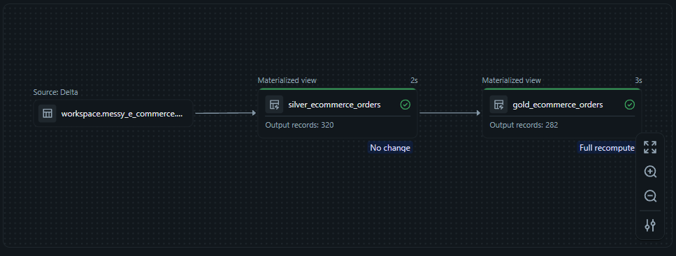
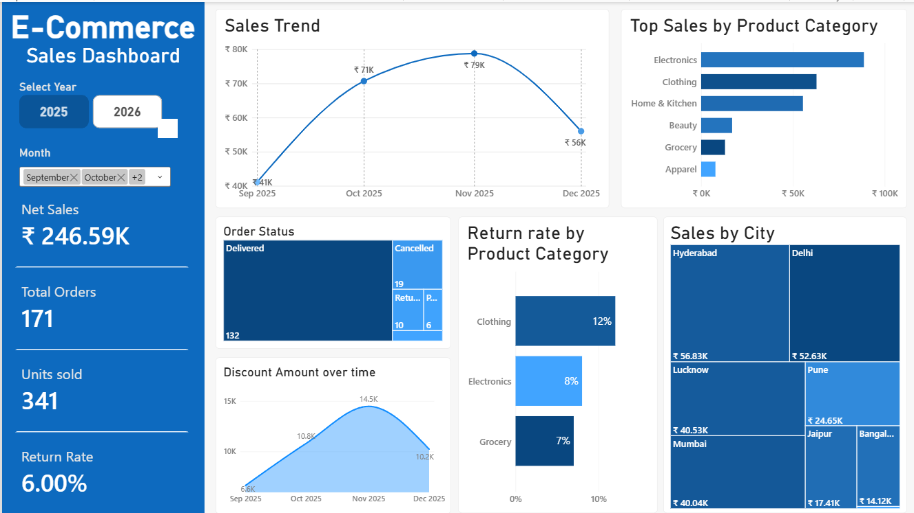

# E-Com End-to-End Using Databricks, Python & Power BI

An end-to-end data engineering and analytics project that takes a **messy e-commerce sales CSV** and turns it into a **clean, analytics-ready Medallion pipeline** and an **interactive Power BI dashboard**, all built on Databricks.

> **Raw & messy data → EDA → ETL (Bronze → Silver → Gold) → Materialized Views → Power BI Dashboard**

---

## Table of Contents

1. [Project Overview](#1-project-overview)
2. [Tech Stack & Project Structure](#2-tech-stack--project-structure)
3. [Databricks Layer: Data Ingestion & EDA](#3-databricks-layer-data-ingestion--eda)
4. [Transformation Layer: ETL & Medallion Architecture](#4-transformation-layer-etl--medallion-architecture)
5. [Dashboarding: Power BI](#5-dashboarding-power-bi)
6. [Key Highlights](#6-key-highlights)

---

## 1. Project Overview

Real-world data is rarely clean. This project works with a deliberately **messy e-commerce orders dataset** containing inconsistent casing, mixed date formats, currency symbols inside numeric fields, placeholder "missing" tokens, duplicate orders, typos in categories, and extreme outliers.

The goal was to build the **complete journey from raw data to business insight**:

- **Ingest** the raw CSV into Databricks as a Delta table
- **Explore (EDA)** the data in Python to identify errors, outliers, required transformations and the **grain** of the data
- **Transform (ETL)** the data in PySpark, driven directly by the EDA findings
- **Organise** the pipeline using the **Medallion Architecture** (Bronze → Silver → Gold)
- **Serve** the Gold layer through materialized views to **Power BI**
- **Visualise** sales, discounts, returns and city/category performance in a dashboard

### What this project demonstrates

| Focus Area | What was done |
|---|---|
| **EDA** | Profiling, missing-value & duplicate analysis, univariate / bivariate / multivariate analysis, 3-way outlier comparison |
| **ETL** | Reusable PySpark cleaning functions for strings, numerics and dates; dedup on grain; derived metrics |
| **Medallion Architecture** | Bronze (raw) → Silver (cleaned) → Gold (business-ready) |
| **Databricks** | Notebooks for EDA, declarative pipeline with materialized views |
| **Power BI** | Interactive dashboard with KPIs, trends, and category/city breakdowns |

---

## 2. Tech Stack & Project Structure

### Tools & Technologies

| Tool | Purpose |
|---|---|
| **Databricks** | Data ingestion, notebooks, pipeline orchestration, materialized views |
| **PySpark** (`pyspark.sql.functions`, `pyspark.pipelines`) | Bronze → Silver → Gold transformations |
| **Python** (pandas, NumPy, Matplotlib, Seaborn) | Exploratory Data Analysis |
| **Delta Lake** | Storage format for the source table |
| **Power BI** | Dashboarding and reporting |

### Pipeline Structure

```
E-com Pipeline
|-- explorations
|   |-- EDA.ipynb
|-- transformations
    |-- bronze_to_silver.py
    |-- silver_to_gold.py
```

| File | Role |
|---|---|
| [`explorations/EDA.ipynb`](/EDA.ipynb) | Data profiling, cleaning prototype, outlier analysis, and bivariate/multivariate exploration |
| [`transformations/bronze_to_silver.py`](/databricks_files/bronze_to_silver.py) | Cleans and standardises raw data into the Silver materialized view |
| [`transformations/silver_to_gold.py`](/databricks_files/silver_to_gold.py) | Adds business metrics, removes outliers, produces the Gold materialized view |

---

## 3. Databricks Layer: Data Ingestion & EDA

### 3.1 Data Ingestion

The raw CSV was ingested into Databricks as a Delta table: [`workspace.messy_e_commerce.messy_ecommerce_orders`](/messy_ecommerce_orders.csv). This table serves as the **Bronze layer / pipeline source**.

### 3.2 Exploratory Data Analysis (`EDA.ipynb`)

EDA was performed in Python **before** writing any transformation logic, so that every cleaning rule in the pipeline is justified by evidence.

**Dataset snapshot (raw):** 329 rows × 10 columns, with 7 fully duplicated rows and 9 duplicate `order_id`s.

#### *Univariate, Bivariate & Multivariate Analysis*

- **Univariate:** descriptive statistics (mean, median, std, skewness, quantiles, IQR), histograms, box plots, and ECDF plots for numeric columns; value counts for categoricals
- **Bivariate:** Pearson & Spearman correlation heatmaps; sales aggregated by city, category and payment method; payment method vs. order status and city vs. order status cross-tabs (normalised heatmaps)
- **Multivariate:** city × category sales pivot and heatmap
- **Time-series:** monthly sales with absolute change, % change and a 3-month rolling average

#### *Outlier Detection: three methods compared*

Because `sale` is highly right-skewed (a few orders worth ₹1.3L–₹3.2L against a typical order of a few thousand), three outlier strategies were tested side by side:

| Method | Rule | Rows flagged |
|---|---|---|
| **IQR** | Outside Q1 − 1.5·IQR / Q3 + 1.5·IQR (upper bound ≈ ₹7,345) | 21 |
| **Fixed threshold** | `sale` > ₹50,000 | 4 |
| **Percentile** | Outside 1st–99th percentile | 8 |

Distributions were compared with histograms, box plots and ECDFs for each method. The **IQR method** was selected for the Gold layer because it produced the most representative distribution for dashboard aggregates.

---

## 4. Transformation Layer: ETL & Medallion Architecture

### Medallion Architecture



| Layer | Object | Output records | Description |
|---|---|---|---|
| **Bronze** | `workspace.messy_e_commerce.messy_ecommerce_orders` (Delta) | 329 | Raw, untouched ingested data |
| **Silver** | `silver_ecommerce_orders` (Materialized View) | **320** | Cleaned, standardised, correctly typed, de-duplicated |
| **Gold** | `gold_ecommerce_orders` (Materialized View) | **282** | Business metrics added, outliers removed, dashboard-ready |

Both Silver and Gold are built as **materialized views** using Databricks' declarative pipeline API (`@dp.materialized_view`), so they refresh automatically as upstream data changes.

---

## 5. Dashboarding: Power BI

The Gold materialized view is connected to Power BI to power an interactive **E-Commerce Sales Dashboard**.



> The KPI values shown in the screenshot (e.g. Net Sales ₹442.89K, 282 orders, 601 units, 4.00% return rate).

---

## 6. Key Highlights

- **Complete end-to-end workflow**: raw messy CSV to a published dashboard, in one platform
- **EDA-driven engineering**: every transformation rule traces back to a finding in `EDA.ipynb`
- **Grain identified and enforced**: one row per `order_id`, with duplicates removed in Silver
- **Reusable cleaning functions**: string, numeric and date cleaners handle 7+ kinds of data issues
- **Robust date parsing**: 5 mixed date formats unified into a single `date` type
- **Evidence-based outlier handling**: IQR, fixed-threshold and percentile methods compared before choosing one
- **Medallion Architecture** implemented with **materialized views** for Silver and Gold
- **Data volume story**: 329 raw rows → 320 after Silver cleaning → 282 after Gold outlier filtering
- **Business-ready output**: Power BI dashboard on top of the Gold layer

---
